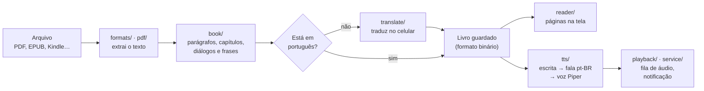

# Contribuindo com o Audiolivre

Obrigado pelo interesse! Este guia é para quem quer compilar o app, mexer no código ou abrir um pull request. Se você só quer usar o app, o [README](README.md) tem tudo.

## Compilar

Precisa do **JDK 17**, do **Android SDK** (plataforma 35), e do **NDK 28** com **CMake 3.22** para o motor de tradução. O Android Studio instala todos.

```bash
git clone https://github.com/fanti1/audiolivre.git
cd audiolivre
bash app/src/main/cpp/fetch_third_party.sh   # código do motor de tradução, nas versões fixadas
./gradlew assembleDebug          # APK em app/build/outputs/apk/debug/
./gradlew testDebugUnitTest      # testes de unidade
```

- Sem o `fetch_third_party.sh`, o app compila do mesmo jeito, mas sai sem o tradutor.
- O APK de debug inclui as bibliotecas x86_64, para rodar no emulador. O de release leva só ARM64.

## APK de release

As releases precisam ser assinadas sempre com a **mesma chave**, ou o Android recusa a atualização por cima da versão instalada. A chave e as senhas ficam fora do repositório: o build lê de um `keystore.properties` na raiz, que o `.gitignore` já ignora.

```properties
storeFile=audiolivre-release.jks
storePassword=...
keyAlias=audiolivre
keyPassword=...
```

Gere com `./gradlew assembleRelease`.

## Como funciona por dentro



| Pacote | O que tem |
|---|---|
| `formats/` | Leitores de EPUB, Kindle, FB2, DOCX, ODT, RTF, HTML, TXT e Markdown; detecção de formato |
| `pdf/` | Extração de texto do PDF (PdfBox) com a geometria de cada linha |
| `book/` | Montagem do livro: parágrafos, capítulos, diálogos, frases; formato binário do cache |
| `translate/` | Detecção de idioma, catálogo e download dos tradutores da Mozilla, tradução com retomada, serviço em segundo plano |
| `tts/` | Motor de voz (sherpa-onnx), normalização pt-BR, siglas, onomatopeias, prosódia, elenco de vozes, modos de memória |
| `playback/` | Fila de síntese com buffer adaptativo, reprodução, ajuste de velocidade |
| `reader/` | Paginação e tela de leitura |
| `service/` | Serviço em primeiro plano, notificação, controles de mídia e timer |
| `ui/` | Biblioteca, voz, tradução, Manual, Sobre, Privacidade e telas de erro |
| `cpp/` | Ponte JNI para o motor de tradução (slimt), compilado com o NDK a partir de `cpp/third_party/slimt` |

## Testes e QA

- `./gradlew testDebugUnitTest` roda os testes de unidade.
- [`qa/README.md`](qa/README.md) explica os scripts em Python que comparam as vozes, conferem a pronúncia, testam a tradução e a acessibilidade e medem o desempenho no aparelho.
- [`docs/MODELS.md`](docs/MODELS.md) descreve as vozes e os tradutores. [`docs/ACESSIBILIDADE.md`](docs/ACESSIBILIDADE.md) traz o plano de acessibilidade.
- As fotos do README saem de `python qa/screenshots.py` (no emulador) e de `python qa/translate_walkthrough.py "<livro em outro idioma>"`.

## Antes de abrir um pull request

1. Rode `./gradlew testDebugUnitTest`.
2. Se mexer na leitura de um formato, adicione um caso em `app/src/test/.../formats/FormatReadersTest.kt`.
3. Se mexer na fala, adicione exemplos em `PtBrNormalizerTest` ou `SpokenFormsTest`.
4. Se mexer numa tela, rode `python qa/a11y_audit.py` no emulador: nenhum botão sem nome nem menor que 48 × 48 dp.

## Licença

Contribuições entram sob a [GPL-3.0](LICENSE), a mesma do app. A GPL-3.0 vem do eSpeak NG, que faz a pronúncia de todas as vozes e vai embutido no app.
