

# Audiolivre

**Todo livro vira audiolivro.** 
Lido em voz alta por IA, direto no celular e sem internet. 
PDF, EPUB, Kindle, Word e mais. Grátis e de código aberto.

  

[Telas](#-telas) ·
[Por que usar](#-por-que-o-audiolivre) ·
[Como funciona](#-como-funciona) ·
[Recursos](#-tudo-o-que-ele-faz) ·
[Vozes](#-vozes) ·
[Instalar](#-como-instalar) ·
[Privacidade](#-privacidade) ·
[Dúvidas](#-perguntas-frequentes)

---

## 📸 Telas

<table>
  <tr>
    <td align="center">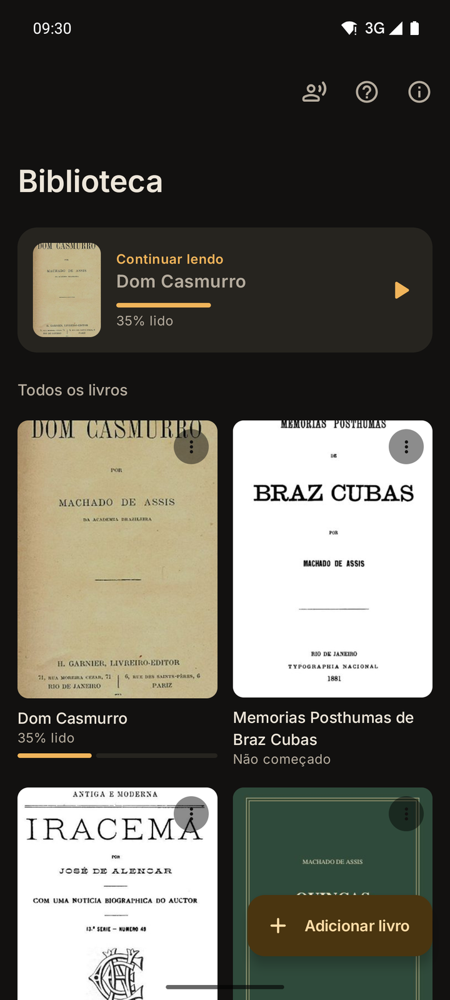 <b>Sua biblioteca</b></td>
    <td align="center">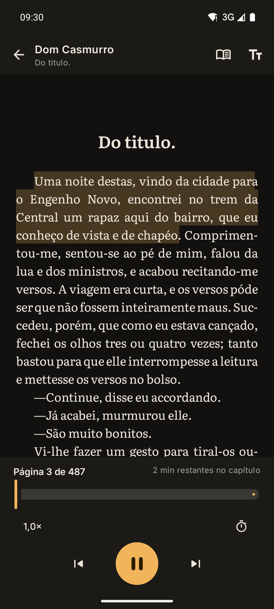 <b>Lendo e ouvindo</b></td>
    <td align="center">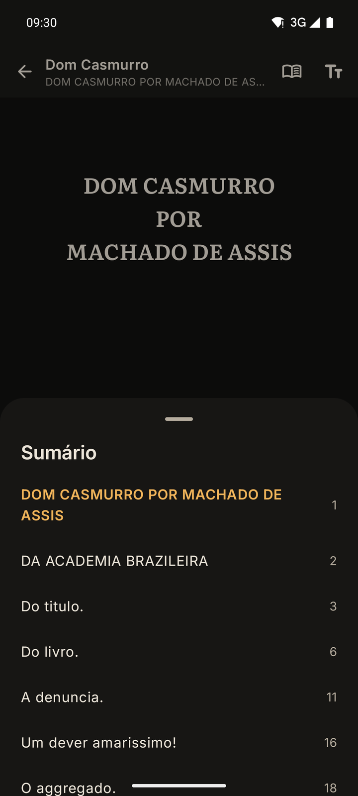 <b>Sumário</b></td>
    <td align="center">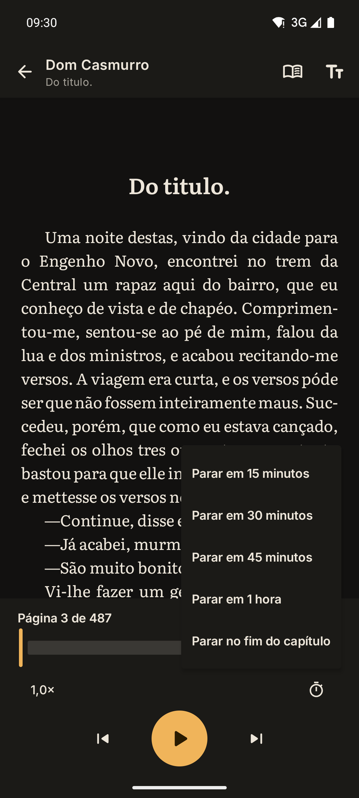 <b>Timer para dormir</b></td>
  </tr>
  <tr>
    <td align="center">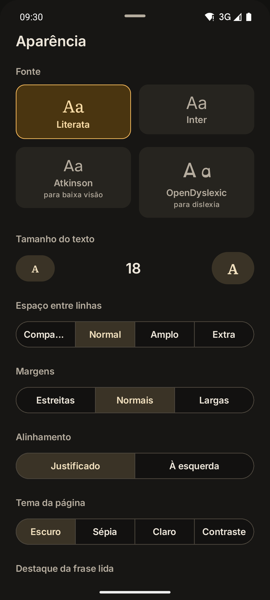 <b>Do seu jeito</b></td>
    <td align="center">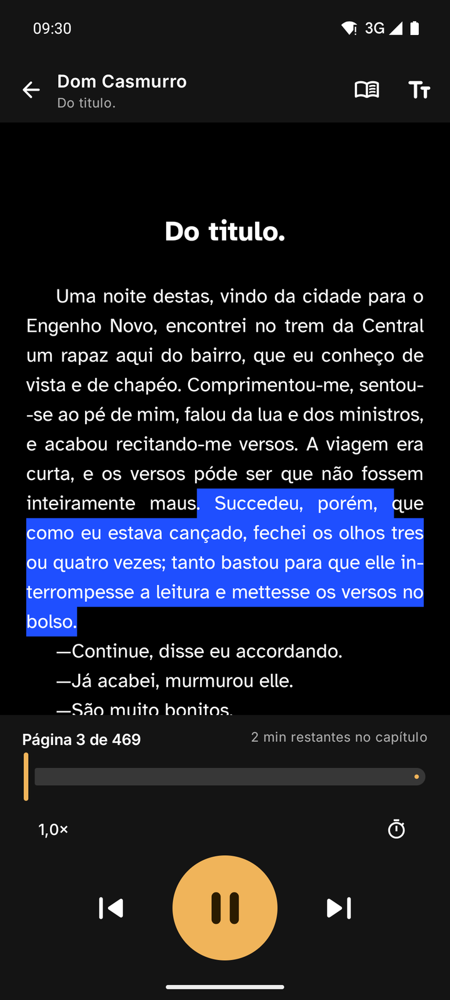 <b>Alto contraste</b></td>
    <td align="center">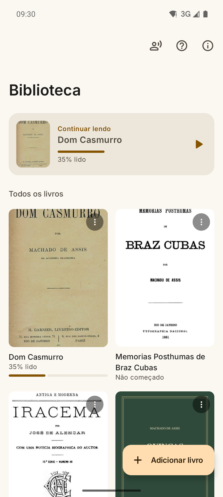 <b>Modo claro</b></td>
    <td align="center">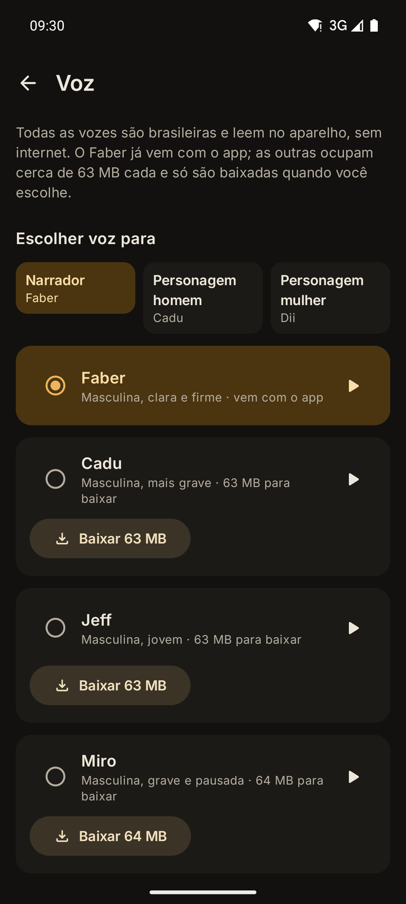 <b>Escolha as vozes</b></td>
  </tr>
  <tr>
    <td align="center">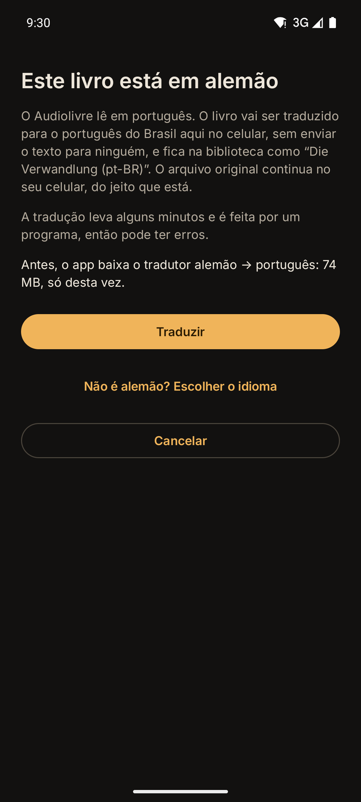 <b>Livro em outro idioma</b></td>
    <td align="center">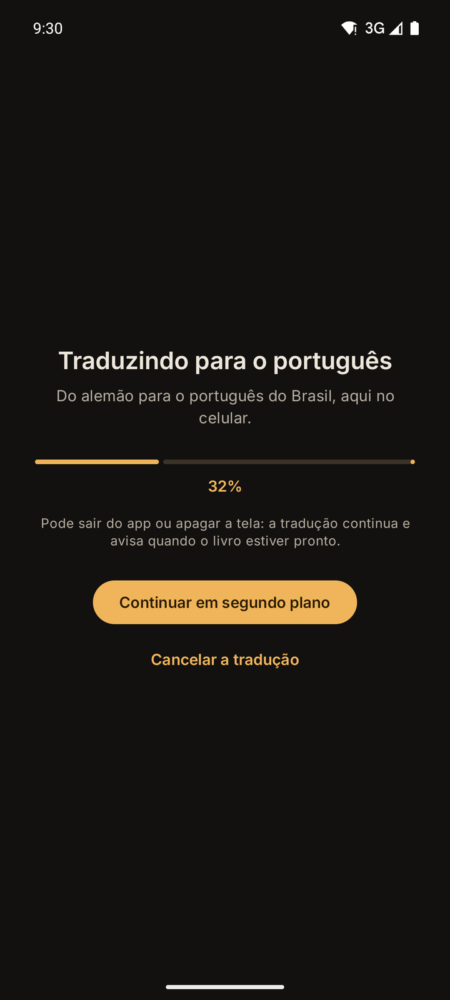 <b>Traduzindo no celular</b></td>
    <td align="center">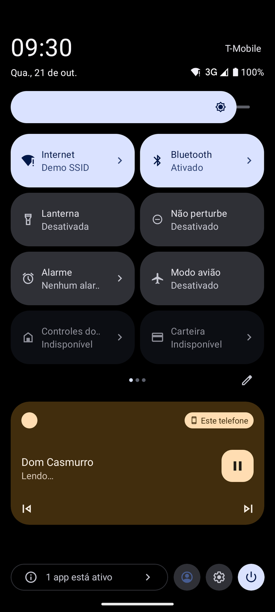 <b>Com a tela desligada</b></td>
    <td align="center">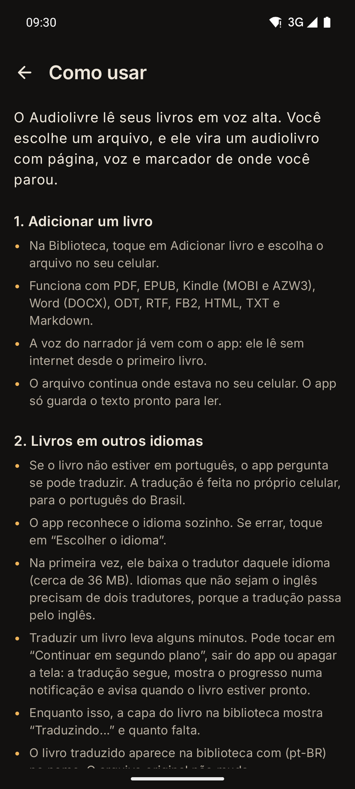 <b>Manual no app</b></td>
  </tr>
</table>

---

## ✨ Por que o Audiolivre

| | |
|---|---|
| 📵 **Tudo no celular** | A voz é gerada no próprio aparelho e a do narrador já vem com o app. Funciona sem internet desde o primeiro livro, até no modo avião. |
| 🎭 **Narração de verdade** | Pausas de narrador entre frases, parágrafos e capítulos, e vozes diferentes para personagens homens e mulheres. |
| 🗣️ **Lê como se fala** | "R$ 1.500,00" vira "mil e quinhentos reais", "Dom Pedro II" vira "Dom Pedro segundo". Nada de voz robótica soletrando símbolos. |
| 🌎 **Qualquer idioma vira português** | Abriu um livro em inglês, espanhol ou alemão? O app traduz para o português do Brasil, no celular. |
| ♿ **Feito para todo mundo** | Funciona com o TalkBack, tem alto contraste, fontes para baixa visão e para dislexia, e controles grandes. |
| 🔒 **Seus livros são seus** | Sem conta, sem anúncios e sem coleta de dados. Nenhum livro sai do celular. |
| 💛 **Grátis para sempre** | Software livre: o código está todo aqui, aberto para qualquer pessoa conferir. |

---

## 🔄 Como funciona

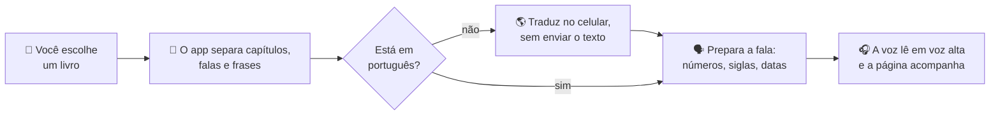

Você só escolhe o livro e aperta ▶️. A voz do narrador já vem com o app. A internet só é usada se você quiser outras vozes ou se o livro for de outro idioma, para baixar o tradutor.

---

## 🧭 Tudo o que ele faz

### 📚 Abre os formatos de livro mais usados

| Formato | Extensões | Observação |
|---|---|---|
| **PDF** | `.pdf` | Precisa ter texto (PDF escaneado, só com imagens, não tem o que ler) |
| **EPUB** | `.epub` | Com sumário e capa |
| **Kindle** | `.mobi` `.azw` `.azw3` `.prc` | Sem DRM |
| **FictionBook** | `.fb2` `.fb2.zip` | Com sumário e capa |
| **Word** | `.docx` | Títulos viram capítulos |
| **LibreOffice** | `.odt` | Títulos viram capítulos |
| **Rich Text** | `.rtf` | |
| **Página da web** | `.html` `.htm` `.xhtml` | |
| **Texto** | `.txt` `.md` | |

Não precisa se preocupar com o nome do arquivo: o app reconhece o formato pelo conteúdo. Livros do **Project Gutenberg** abrem sem o aviso em inglês que vem no começo e no fim.

### 🌎 Traduz livros de outros idiomas

Abriu um livro em inglês, espanhol, francês, alemão, italiano ou em outro dos mais de 50 idiomas disponíveis? O app reconhece o idioma e oferece traduzir para o **português do Brasil**:

- a tradução usa os mesmos modelos do tradutor do **Firefox** e acontece **no celular, sem enviar o texto para ninguém**;
- na primeira vez, o app baixa o tradutor daquele idioma (cerca de 36 MB);
- a tradução acontece **em segundo plano**: dá para sair do app ou desligar a tela. Uma notificação mostra o progresso e avisa quando o livro fica pronto. Se o celular desligar no meio, ela continua de onde parou;
- o livro traduzido entra na biblioteca com **(pt-BR)** no nome, e o arquivo original continua intacto no celular.

A tradução é automática e pode errar, principalmente em nomes próprios, poesia e trocadilhos.

### 🎧 Narração que soa como narração

- **Vozes neurais em português do Brasil**, geradas no próprio celular.
- **Pausas de narrador:** a pausa entre frases é diferente da pausa entre parágrafos, cenas e capítulos. Reticências deixam a frase "no ar" por mais tempo.
- **Vozes para os personagens:** o app reconhece as falas (travessão e aspas) e, quando o texto mostra se quem fala é homem ou mulher, troca a voz. O narrador continua com a voz dele.
- **Velocidade de 0,7× a 2,0×**, com atalhos no próprio player.

### 🗣️ Lê o que está escrito do jeito que se fala

A página continua mostrando o texto original. Só o que a voz fala muda:

| Está escrito | O Audiolivre fala |
|---|---|
| `R$ 1.500,00` | mil e quinhentos reais |
| `7h30` | sete horas e trinta minutos |
| `1º lugar` · `1ª vez` | primeiro lugar · primeira vez |
| `Dom Pedro II` · `século XIX` | Dom Pedro segundo · século dezenove |
| `Sra. Silva` · `Sr. Almeida` | senhora Silva · senhor Almeida |
| `O CPF e o RG.` | O cê pê éfe e o érre gê. |
| `50%` · `12,5%` | cinquenta por cento · doze vírgula cinco por cento |
| `N-n-não sei.` | Nã... nã... não sei. |
| `Shhhh.` · `Hahaha!` · `Toc-toc-toc.` | Psiu. · Rá rá rá! · Tóque, tóque, tóque. |
| `Vinte e seis annos de intervallo.` | Vinte e seis anos de intervalo. |

> Clássicos em domínio público costumam usar a ortografia antiga ("elle", "annos", "chamal-a"). O app moderniza só a fala, para a voz não tropeçar.

### 📖 Leitura confortável

- **Páginas de verdade**, como num leitor de e-book, com número da página e porcentagem lida.
- **A frase que está sendo lida fica destacada** e a página vira sozinha, acompanhando a voz.
- **Segure o dedo numa frase → "Ler a partir daqui".**
- Folheou para longe? O botão **"Voltar ao áudio"** traz você de volta para onde a voz está.
- **Sumário**, barra para pular páginas e **tempo restante do capítulo**.
- **Aparência:** 4 fontes, 13 tamanhos de letra, espaço entre linhas, margens, texto justificado ou à esquerda, temas **Escuro, Sépia, Claro e Contraste** e ajuste de brilho.
- **Timer para dormir:** a leitura para depois de 15, 30, 45 ou 60 minutos, ou no fim do capítulo.
- Os botões do **fone de ouvido** tocam, pausam e pulam frases. Num **teclado**, as setas viram a página e o espaço toca e pausa.

### ♿ Acessível

- Funciona com o **TalkBack**: cada livro da biblioteca é lido como um item só, cada parágrafo da página é lido em separado, e "Ler a partir daqui", "Próxima página" e "Página anterior" aparecem nas ações do TalkBack.
- Fontes **Atkinson Hyperlegible** (para baixa visão) e **OpenDyslexic** (para dislexia), letra bem grande e tema de **alto contraste**.
- Destaque da frase lida **suave, forte ou sublinhado**. O sublinhado serve para quem não distingue bem as cores.
- **Modo foco**, que escurece o resto da página e deixa só a frase lida em evidência.
- **Controles grandes** para quem tem dificuldade de acertar botões pequenos.
- Segue o **modo claro ou escuro** do celular.

O que ainda vamos melhorar está em [`docs/ACESSIBILIDADE.md`](docs/ACESSIBILIDADE.md). Se você usa leitor de tela, sua opinião vale ouro: [conte para a gente](https://github.com/fanti1/audiolivre/issues/new?template=acessibilidade.md).

### 🧹 PDFs sem bagunça

PDFs são feitos para imprimir, não para ler em voz alta. O app arruma isso antes:

- tira **cabeçalhos, rodapés e números de página** que se repetem, para a voz não ler "página 32" no meio da frase;
- **junta palavras quebradas por hífen** no fim da linha;
- corrige **letras capitulares** e caracteres estranhos;
- entende páginas em **duas colunas**;
- encontra os **capítulos** sozinho.

### 🗂️ Biblioteca

- Capas (a do próprio livro, ou uma com o título quando o livro não tem), progresso de cada livro e um atalho para **continuar lendo**.
- Guarda **a posição exata de cada livro**.
- **Continua tocando com a tela desligada**, com controles na notificação e na tela de bloqueio. Pausa sozinho quando chega uma ligação.
- Um manual **"Como usar"** dentro do próprio app.

---

## 🎤 Vozes

Todas em português do Brasil. Você ouve uma amostra de cada uma e escolhe quem narra e quem faz as vozes dos personagens.

| Voz | Estilo | Tamanho |
|---|---|---|
| **Faber** | Masculina, clara e firme *(narrador padrão)* | já vem com o app |
| **Cadu** | Masculina, mais grave *(personagens masculinos)* | ~63 MB |
| **Dii** | Feminina *(personagens femininas)* | ~64 MB |
| **Jeff** | Masculina, jovem | ~63 MB |
| **Miro** | Masculina, grave e pausada | ~64 MB |
| **Edresson** | Masculina, gravação mais simples | ~63 MB |

O **Faber** já vem instalado, então o primeiro livro começa a tocar na hora, sem download. As outras vozes você baixa quando quiser, na tela **Voz**. Até lá, os personagens falam com a voz do narrador.

---

## 📥 Como instalar

1. No celular, abra a página de [**Releases**](https://github.com/fanti1/audiolivre/releases/latest) e baixe o arquivo **`.apk`** mais recente.
2. Abra o arquivo baixado. Se o Android pedir, permita **"Instalar apps desconhecidos"** para o navegador ou para o gerenciador de arquivos.
3. Se aparecer um aviso do **Play Protect**, toque em **"Mais detalhes" → "Instalar mesmo assim"**. Isso acontece com qualquer app instalado fora da Play Store.
4. Abra o Audiolivre, toque em **Adicionar livro** e escolha um arquivo.
5. Toque em ▶️. A voz do narrador já vem com o app, não precisa baixar nada.

**Para atualizar:** baixe o APK novo e instale por cima. Seus livros, posições de leitura e vozes continuam lá.

---

## 📱 Requisitos

| | |
|---|---|
| **Android** | 8.0 (Oreo) ou mais novo |
| **Celular** | Qualquer celular dos últimos anos (precisa de processador de 64 bits, o que quase todos têm) |
| **Espaço** | ~112 MB do app, já com a voz do narrador, mais ~63 MB para cada outra voz que você baixar |
| **Internet** | Não precisa para ler. Só para baixar outras vozes e, se precisar, os tradutores |

---

## 🔒 Privacidade

- **Sem conta, sem anúncios e sem coleta de dados.**
- Seus livros não saem do celular. Tudo acontece no aparelho, inclusive a voz e a tradução, e o app fica fora do backup automático do Android.
- A internet só é usada para baixar outras vozes, que vêm do GitHub, e os tradutores, que vêm da Mozilla (a mesma do Firefox). Nenhum dado seu vai junto.
- O app pede apenas:
  - **Internet**, para baixar as vozes e os tradutores;
  - **Notificações**, para mostrar os controles enquanto o livro toca e o andamento da tradução;
  - **Continuar funcionando com a tela desligada**, para ler e traduzir em segundo plano;
  - **Ignorar a economia de bateria**, só se você pedir, para o Android não interromper a leitura.
- O app não pede acesso aos seus arquivos: você escolhe cada livro pelo seletor do próprio Android.
- A política completa, escrita de acordo com a LGPD (Lei 13.709/2018), está no app em **Sobre → Privacidade e LGPD**.

---

## ❓ Perguntas frequentes

<b>Onde encontro livros gratuitos?</b>

 
Clássicos em domínio público estão no <a href="https://www.gutenberg.org/browse/languages/pt">Project Gutenberg</a> (baixe em EPUB), no <a href="http://www.dominiopublico.gov.br">Domínio Público</a> do governo federal (PDF) e no <a href="https://pt.wikisource.org">Wikisource</a>.

<b>Preciso de internet para ouvir?</b>

 
Não. A voz do narrador já vem com o app, então ele lê sem internet desde o primeiro livro, até no modo avião. A internet só é usada se você quiser baixar outras vozes ou traduzir um livro de outro idioma.

<b>É seguro instalar um APK fora da Play Store?</b>

 
O aviso do Android aparece para qualquer app de fora da loja. O código do Audiolivre é todo público, aqui neste repositório, e cada versão nas <a href="https://github.com/fanti1/audiolivre/releases">Releases</a> traz o código de verificação (SHA-256) do APK. Baixe sempre por aqui.

<b>Meu livro do Kindle ou de uma loja não abre.</b>

 
Livros comprados em lojas costumam ter <b>DRM</b>, uma trava contra cópia que só o app da própria loja abre. O Audiolivre avisa quando encontra DRM. Livros sem DRM (de autores independentes, do Project Gutenberg, ou convertidos no <a href="https://calibre-ebook.com">Calibre</a>) abrem normalmente.

<b>Abri um PDF e apareceu "Não foi possível extrair texto". Por quê?</b>

 
Esse PDF provavelmente é escaneado, ou seja, cada página é uma foto, sem texto de verdade por trás. O app precisa do texto para ler. Tente outra edição do livro ou passe o PDF por um programa de OCR antes.

<b>E arquivos .doc do Word antigo?</b>

 
O formato <code>.doc</code> (Word 97–2003) não é suportado. Abra no Word ou no LibreOffice e salve como <code>.docx</code>.

<b>A voz de um personagem saiu errada. É bug?</b>

 
Pode acontecer. O app adivinha se quem fala é homem ou mulher pelo texto ("disse ela", "respondeu o velho"). Quando não há pistas, a fala fica com o narrador. Se preferir tudo numa voz só, desligue <b>"Personagens com voz própria"</b> na tela Voz.

<b>Lê livros em inglês ou espanhol?</b>

 
Lê, traduzindo antes para o português do Brasil. Ao abrir um livro em outro idioma, o app oferece a tradução, feita no próprio celular. As vozes falam só português.

<b>O áudio para quando a tela desliga.</b>

 
O Android pode fechar apps em segundo plano para economizar bateria. Na tela <b>Voz</b>, em <b>"Ler com a tela desligada"</b>, toque em <b>"Permitir leitura em segundo plano"</b>. Alguns fabricantes (Xiaomi, Samsung, Motorola, OnePlus...) têm ainda um ajuste próprio: nas configurações do Android, procure <b>Bateria → Audiolivre</b> e escolha <b>"Sem restrições"</b>.

<b>Por que não está na Play Store?</b>

 
Por enquanto, o Audiolivre é distribuído só por aqui, nas <a href="https://github.com/fanti1/audiolivre/releases">Releases</a>.

---

## 🐞 Encontrou um problema? Tem uma ideia?

Abra uma [**issue**](https://github.com/fanti1/audiolivre/issues/new/choose) contando:

- o que aconteceu, e o formato do arquivo (PDF, EPUB...);
- o **relatório de suporte**: no app, em **Sobre → Relatório de suporte**, toque em **Copiar** e cole na issue. Ele traz o modelo do celular, a versão do Android e os erros recentes, sem nada dos seus livros;
- se o app fechou sozinho: na próxima vez que você abrir, ele mostra o erro com um botão **"Copiar erro"**. Cole esse texto também.

Se o problema for com um livro específico, diga qual é (título e editora). **Não anexe livros protegidos por direitos autorais.**

---

## 🤝 Quer ajudar?

- **Use e conte o que achou.** Ideias e problemas viram melhorias.
- **Usa leitor de tela?** Sua experiência com o TalkBack ajuda muito.
- **Indique para alguém** que gosta de audiolivros, tem baixa visão ou dislexia, ou prefere ouvir a ler.
- **É desenvolvedor?** Veja o [guia para contribuir](CONTRIBUTING.md).

---

## 🙏 Créditos

O Audiolivre só existe graças a estes projetos livres:

| Projeto | O que faz no app | Licença |
|---|---|---|
| [sherpa-onnx](https://github.com/k2-fsa/sherpa-onnx) · [ONNX Runtime](https://github.com/microsoft/onnxruntime) | Gera a voz no celular | Apache 2.0 · MIT |
| [Piper](https://github.com/rhasspy/piper) / [piper-voices](https://huggingface.co/rhasspy/piper-voices) | As vozes em português | Faber, Cadu e Jeff: dados CC0 · Edresson: CC BY 4.0 · Miro e Dii: ver o MODEL_CARD de cada voz |
| [TTS-Portuguese Corpus](https://github.com/Edresson/TTS-Portuguese-Corpus) (Edresson Casanova) | Gravações da voz Edresson | CC BY 4.0 |
| [eSpeak NG](https://github.com/espeak-ng/espeak-ng) | Pronúncia das palavras | GPL-3.0 |
| [Firefox Translations](https://github.com/mozilla/translations) (Mozilla) | Modelos de tradução | MPL 2.0 |
| [slimt](https://github.com/jerinphilip/slimt), na [versão de David Ventura](https://github.com/DavidVentura/slimt) · [SentencePiece](https://github.com/google/sentencepiece) · [ruy](https://github.com/google/ruy) · [cpuinfo](https://github.com/pytorch/cpuinfo) | Faz a tradução no celular | GPL-2.0 ou posterior · Apache 2.0 · Apache 2.0 · BSD |
| [PdfBox-Android](https://github.com/TomRoush/PdfBox-Android) | Lê os PDFs | Apache 2.0 |
| [Apache Commons Compress](https://commons.apache.org/proper/commons-compress/) · [XZ for Java](https://tukaani.org/xz/java.html) | Abre as vozes baixadas | Apache 2.0 · Domínio público |
| [Literata](https://github.com/googlefonts/literata) · [Inter](https://github.com/rsms/inter) · [Atkinson Hyperlegible](https://www.brailleinstitute.org/freefont/) · [OpenDyslexic](https://opendyslexic.org) | Fontes de leitura | SIL Open Font License 1.1 |
| [Jetpack Compose / AndroidX](https://developer.android.com/jetpack) · [Kotlin Coroutines](https://github.com/Kotlin/kotlinx.coroutines) | Telas e base do app | Apache 2.0 |

---

## 📄 Licença

O Audiolivre é **software livre**, sob a [GNU General Public License v3.0](LICENSE). Você pode usar, estudar, modificar e compartilhar o app à vontade. Se distribuir uma versão modificada, ela também precisa ser livre e ter o código publicado.

O nome vem daí: **audiolivro** + **livre**.

 
Feito com ☕ e muitos livros em domínio público.

